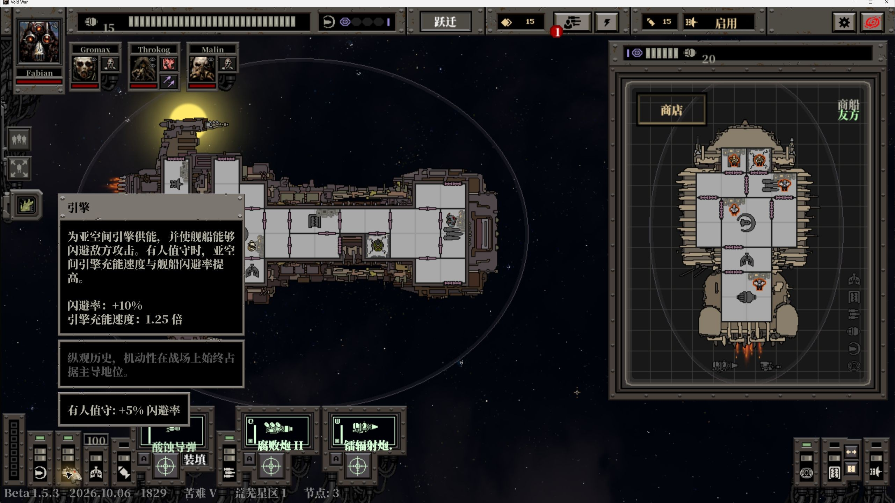
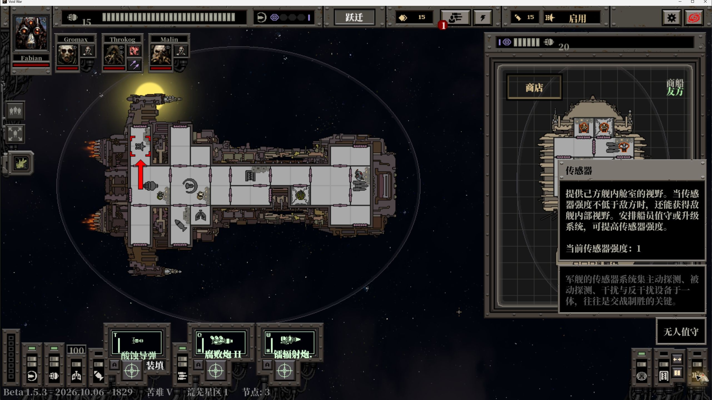
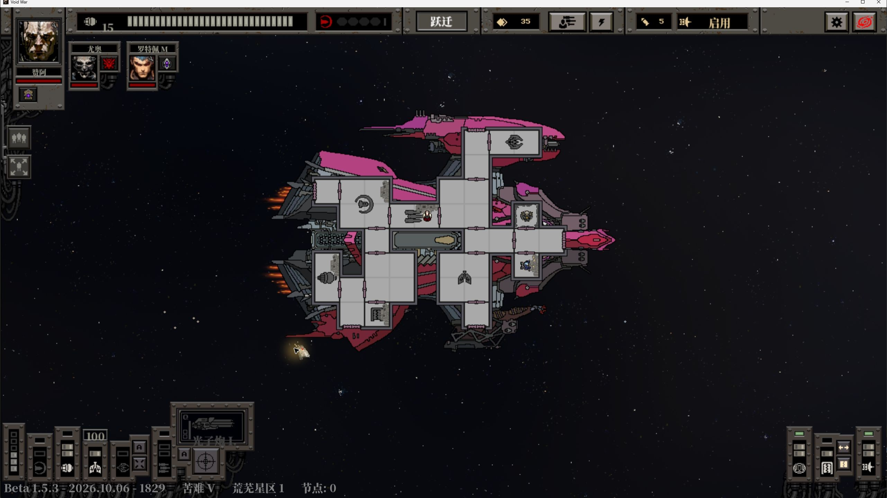

# Void War 1.5.3 beta 汉化安装说明

补丁 **2026.10.10.4** 支持 **Void War 1.5.3 beta / Steam build 25749411**，Windows x64。

**汉化补丁下载 / Patch Download：[VoidWar_Chinese_Patch.exe](https://github.com/UNKNOWNTIMER/void-war-zh-cn/releases/latest/download/VoidWar_Chinese_Patch.exe)**

此固定地址指向最新版本。若游戏仍为 1.5.2b / build 25669267，请使用 [2026.10.10.3 稳定版专用包](https://github.com/UNKNOWNTIMER/void-war-zh-cn/releases/download/v2026.10.10.3/VoidWar_Chinese_Patch.exe)。不要把两种版本的汉化资源互相覆盖。

## 安装步骤

1. 打开 Steam 游戏库，右键 Void War → 属性 → 测试版，切换到 beta 分支，等待游戏更新。确认对应的是 **1.5.3 beta / build 25749411**。游戏后续 beta 若改变了资源，即使显示相同版本号，也可能不受当前包支持。
2. 若以前装过稳定版补丁，先用旧包“还原原版”，再更新或验证游戏文件。Steam 的“属性 → 已安装文件 → 验证游戏文件完整性”可以取回当前分支的原始资源。
3. 正常启动游戏一次，再正常退出。这样游戏会生成自己的设置文件。安装时游戏必须关闭。
4. 下载 EXE，放在普通文件夹中，双击运行。不需要安装 Python，不需要把 EXE 放进游戏目录。
5. 检查路径框。自动识别失败时，点击“选择目录”，选择包含 `Void War.exe` 和 `data.win` 的 **Void War 文件夹**，不是 steamapps 或 common 的上一级目录。
6. 点击“一键安装 / 更新汉化”。安装器先核对版本和散列，再保留原版备份，生成目标资源并校验。若写入受保护位置需要权限，会出现 Windows UAC。
7. 等待界面显示“汉化已安装并通过散列校验，可从 Steam 正常启动。”，再关闭安装器，从 Steam 启动游戏。


安装器顶部没有系统标题栏和额外状态栏，关闭按钮“×”在界面右上角。按住顶部标题区域可以拖动窗口；执行安装、还原时等待操作结束，再关闭。

第一次载入中文字体可能需要等待一段时间。主菜单左下方显示 **汉化作者：UNKNOWNTIMER | 适配：Void War 1.5.3 beta / Steam build 25749411**。作者与适配标注只出现在主菜单，不覆盖公告、制作人员页、设置或游戏中的对话。


常见游戏路径是 `C:\Program Files (x86)\Steam\steamapps\common\Void War`，也可以是其他 Steam 库。安装器按文件内容识别版本，路径和目录名本身不能证明兼容。

## 更新与还原

再次运行 EXE，选好相同游戏目录，可以重新安装本版本或点击“还原原版”。

本 beta 包使用 **`_VoidWar_Chinese_Original_1_5_3_beta`** 原版备份。旧稳定版备份 **`_VoidWar_Chinese_Original`** 保留供旧版使用，不与 beta 混用。不要删除、移动或手工改写备份目录。还原后备份继续保留，便于后续重新安装。

还原恢复的是**安装前的对应游戏资源和语言设置**。如果安装前语言已是中文，还原不会强行把语言设为英文。需要改回英文，可在游戏设置中自行选择 English。

安装和还原只调整当前设置里的语言字段，保留你后来获得的解锁、分数及进度；安装器不写入自动存档和分数文件，也不会拿备份中的旧 profile 覆盖当前 profile。

遇到 Steam 更新：先使用对应旧包还原，再更新游戏；更新或验证覆盖补丁后，用适配更新后资源的新包重新安装。遇到版本不匹配提示时，不要修改 SHA-256 或把旧的 `data.win` 塞进新版本。

## 常见问题

| 情况 | 处理 |
|---|---|
| 提示游戏版本或 data.win 不匹配 | 确认 beta 分支、build 25749411 和原始资源。新版 beta 资源改变后需要新适配包；稳定版使用历史专用包。 |
| 未找到游戏设置存档 | 先从 Steam 正常启动一次游戏并退出，再打开安装器。 |
| 提示游戏仍在运行 | 退出游戏后重试；不要在游戏读取资源时安装。 |
| 提示原版备份或当前文件被改变 | 保留备份和现场；不要覆盖未知文件。可先用 Steam 验证当前分支，并附错误代码反馈。 |
| 游戏启动时黑屏一段时间 | 字体加载较大，先等待。若长时间无响应，附游戏和补丁版本反馈。 |
| 切回 English 后部分字仍是中文 | 少量名称、贴图标题和脚本提示属于资源层汉化；使用“还原原版”才能恢复完整原始资源。 |
| 旧角色名仍是英文 | 玩家自定义名和旧存档已有姓名保留；新生成的名称使用汉化后的名称资源。 |
| 未签名提示 | 当前 EXE 未代码签名。只从本项目发行页下载，并用发行页校验文件核对散列。 |

## 已修复的界面

引擎／传感器说明按中文实际字宽换行，避免叠字；船员头像名调整字号和基线，过长名字按可用宽度截断；公告缓存排版并跳过屏外绘制。商人随机闲聊补齐独立台词池，并修复缺失语言条目时出现英文报错的路径。







本次逐句修订 27 个 beta 新增／变更语言键，另补齐 156 条脚本随机传闻。全部静态文本及字体检查、游戏内代表场景和安装器实际操作详见 [QUALITY.md](QUALITY.md)。不把静态覆盖率等同于游玩完每一种随机分支。

## 文件校验与反馈

发行页提供 `SHA256SUMS.txt`。可在 PowerShell 执行：

```powershell
Get-FileHash -Algorithm SHA256 -LiteralPath '.\VoidWar_Chinese_Patch.exe'
```

将结果与同一发行页的校验值比较。源码和构建方法见 [BUILD.md](BUILD.md)，问题通过 [GitHub Issues](https://github.com/UNKNOWNTIMER/void-war-zh-cn/issues) 反馈。请提供游戏版本、build、补丁版本、界面、步骤和截图，不必上传账号信息、存档或完整游戏资源。

安装器完全离线，不上传路径、存档和账户信息。补丁不含完整游戏，需自行拥有合法游戏副本。
