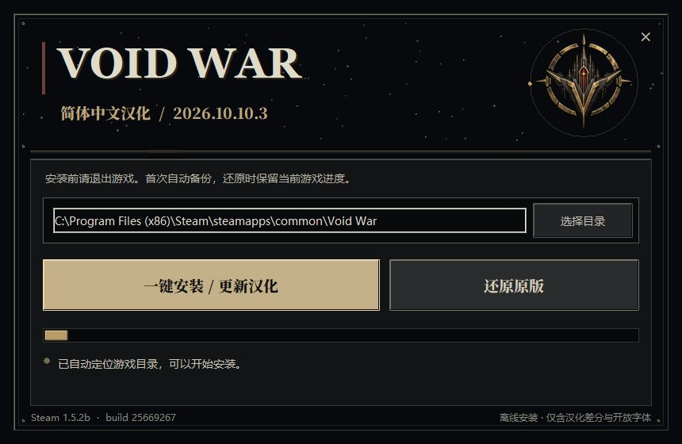
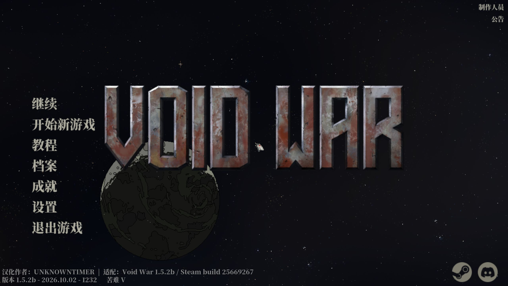

# Void War 简体中文补丁使用说明书

补丁版本：2026.10.10.3。适配 Windows x64 的 **Void War 1.5.2b / Steam build 25669267**。这是非官方资源补丁，使用前须已安装对应版本游戏。

## 下载与安装

1. 从 [GitHub 发行页](https://github.com/UNKNOWNTIMER/void-war-zh-cn/releases/latest) 下载 `VoidWar_Chinese_Patch.exe`，需要校验时同时下载 `SHA256SUMS.txt`。
2. 退出游戏。首次使用游戏的玩家，先正常启动游戏一次并退出，以建立设置文件。
3. 双击 EXE。程序会尝试定位 Steam 目录；目录不正确时，点击“选择目录”，选择包含 `Void War.exe` 与 `data.win` 的 Void War 文件夹。
4. 点击“一键安装 / 更新汉化”。等待面板显示“汉化已安装并通过散列校验，可从 Steam 正常启动。”，再关闭补丁器并从 Steam 启动游戏。
5. 进入主菜单确认中文及适配版本。需要检查语言时，进入“设置 → 语言 → 简体中文”。

补丁器是单文件程序，无需 Python。界面顶部没有原生标题栏；按住标题区域可移动窗口，右上角的“×”关闭程序。文件事务进行中暂不能关闭，完成校验后可以正常关闭。



字体较大，游戏首次加载可能黑屏一段时间，请等待载入完成。玩游戏时不用保持补丁器运行。

## 适配版本

本版只支持 1.5.2b / build 25669267 的已验证资源。原版 `data.win` SHA-256 为：

```text
1d8bb23910251b7bc50f1013efbec18ce0cf030894e7d2de50c4bdadfb9f8db9
```

Steam 可能更新主分支或测试分支。**1.5.3 beta / build 25749411 不受本包支持**。本次发行按已回滚的 1.5.2b 资源验证；beta 差异资料单独保留。不同资源版本会被安装器拒绝，请等待对应版本补丁。不要通过改清单、替换散列或手工覆盖旧 `data.win` 绕过检查。

中文主菜单会显示“汉化作者：UNKNOWNTIMER”及“适配：Void War 1.5.2b / Steam build 25669267”。该署名只在主菜单出现，原来的游戏版本信息也保留。



## 还原与更新

重新运行 EXE，确认同一目录，点击“还原原版”。还原只恢复资源及原语言设置，不用历史设置文件覆盖后来的进度。

首次安装创建的 `_VoidWar_Chinese_Original` 原版备份目录应一直保留。已知旧汉化可接续升级；其他模组或不同版本资源可能需要先各自还原。Steam 验证文件完整性可能覆盖汉化。

## 常见情况

| 提示或现象 | 处理方法 |
| --- | --- |
| 找不到游戏 | 选择包含 EXE 和 `data.win` 的游戏文件夹。 |
| 游戏正在运行 | 正常退出游戏后重新操作。 |
| 资源版本不匹配 | 查看游戏版本及分支，使用对应补丁。 |
| 没有设置文件 | 先正常启动游戏一次，再退出安装。 |
| 写入权限不足 | 按程序提示完成系统权限授权。 |
| 操作中断 | 保留备份，重新运行同一个补丁器；程序会先检查并恢复未完成事务。 |
| 希望完全恢复英文 | 使用“还原原版”，部分资源层汉化切回 English 后仍为中文。 |

## 覆盖与限制

三张语言表共 12,872 条记录，其中剧情和对话 8,348 条已完成 AI 逐句对照精修。原文空槽保持为空，品牌、快捷键、制作人员姓名和程序变量保留。使用 OFL 中文字体并修复换行、部分基线、商店及部署／召回标题。

安装器离线运行，不收集账户、存档或使用数据。公开发行物仅包含汉化差分、中文表、字体、说明和补丁器，不包含完整游戏或玩家存档。

本项目未经过官方或专业人工译审，也未遍历所有随机剧情分支。实际验证范围和已知限制见 [QUALITY.md](QUALITY.md)。问题反馈请使用 [Issues](https://github.com/UNKNOWNTIMER/void-war-zh-cn/issues)，附游戏版本、补丁版本、复现步骤和截图。
