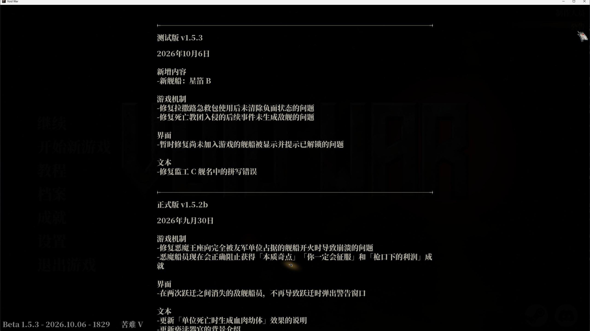
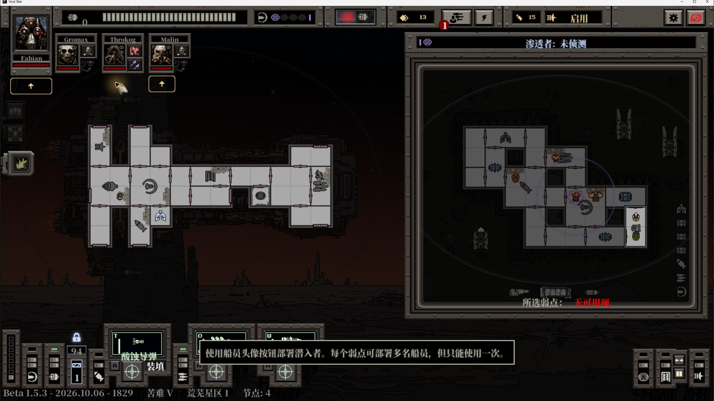
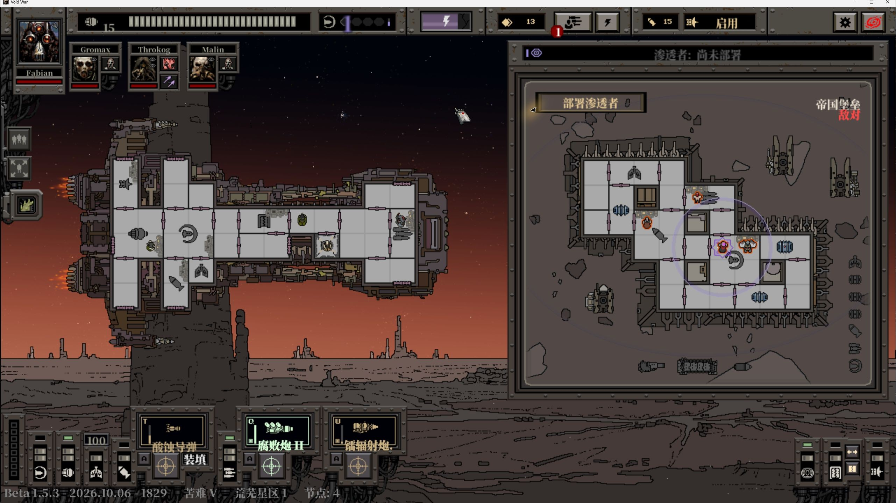
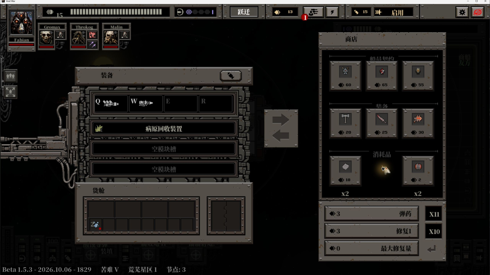
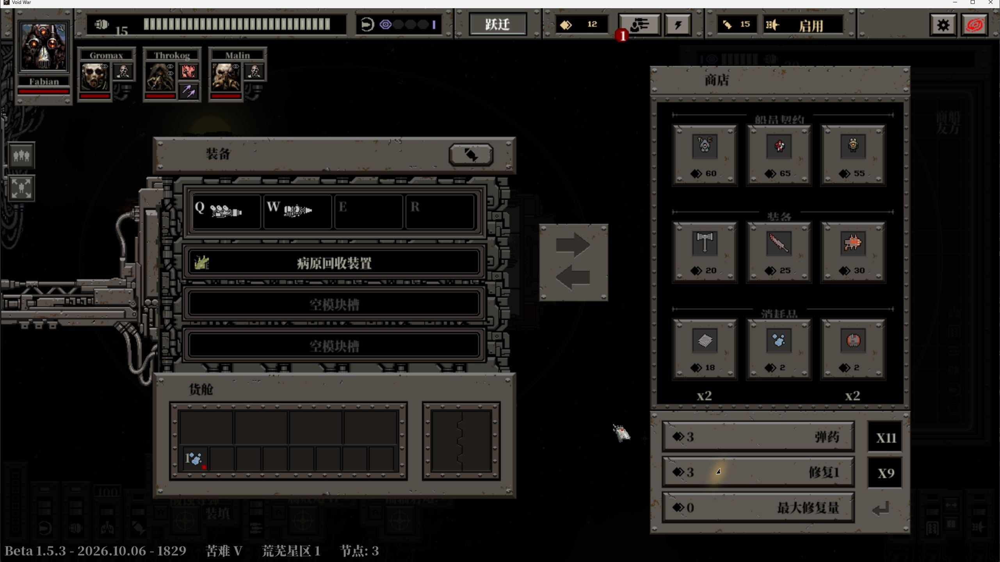
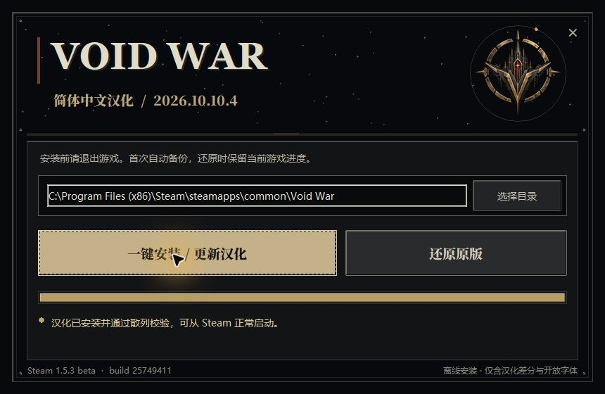

# 汉化与验证记录

本记录对应 **2026.10.10.4**，适配 **Void War 1.5.3 beta / Steam build 25749411**。验证于 2026-10-10 在 Windows x64 进行。稳定版旧记录保存在 [QUALITY-1.5.2b.md](QUALITY-1.5.2b.md)，本版完整验收数据见 [validation-1.5.3-beta.json](docs/validation-1.5.3-beta.json)。

## 文本覆盖与逐句校订

沿用上一稳定版已校订的译文，与 beta 原始语言表逐键对比。三张表共 **12,874 个键**：功能提示 726 条，界面及物品 3,800 条，剧情及对话 8,348 条。原文中的 592 个空槽保持为空，98 组运行时标记通过一致性检查。

对 beta 新增或变更的 **27 个键**逐句对照原文复核，包括 6 个界面键及 21 个剧情／对话键。星箔 B 的舰名、完整舰船背景、1.5.3 公告、死亡教团后续事件及修改后的节点描述均已更新。数值含义、人物称谓及条件关系保留；例如 27.3 billion 译为 273 亿，三分之二保持原比例。

另发现不经过语言表的 **156 条商人传闻**，逐条翻译到实际脚本使用的字符串池：通用 33 条、机械教团 51 条、鲜血教团 44 条、战神教团 28 条。修复中文语言槽找不到传闻条目时显示错误消息的问题，沿用原作现有随机文本与动态标签处理流程。随机池顺序、权重、引用链和资源偏移保持一致。

最终扫描并复核语言表中含拉丁字符的 99 行，未发现未解释的英文词。保留品牌、制作人员姓名、键帽、型号、罗马数字、网址及变量，不将它们误改成普通中文叙述。历史公告解释模板的“[阵营]”属于示例，运行时占位符保持原结构。156 条活动传闻池中普通英文叙述残留为 0。此结果针对实际显示文本，不代表把游戏内部的英文符号、程序名和诊断字符串改写。

## 字体排版与公告性能

继续使用 Noto Serif CJK SC Black。最终语言表及实际中文引擎字串所需的 **2,897 个非空白字符**，在外置 OTF 和两个实际使用的内嵌字体 FONT40、FONT43 中均能找到；缺字与所需字形的空矩形均为 **0**。

引擎／传感器介绍改用共同的正文绘制路径，以实际字体测量字宽并处理逐字换行。修正原调用把行距 0 传入后导致多行文字挤在同一行的问题，文字高度与绘制使用同一换行结果；保留显式换行，避免句末标点单独挤到下一行。

船员头像姓名统一使用 0.65 缩放与调整后的基线，截断计算与绘制比例一致。正常新局已检查指挥官及两名船员的名字位置；旧存档中已生成的姓名按原值保留。

公告加入最多 256 项的布局缓存，键包含字体、分辨率、宽度、行距与文本；复用已换行文字，跳过屏幕外正文的绘制，保留滚动范围与关闭操作。实际打开公告，向下滚动 12 次、向上滚动 14 次并返回顶部，均正常响应。此结论是操作验收，未进行帧率、帧时间或所有分辨率的性能基准。


## 游戏实测范围

普通游戏中实测主菜单署名和版本、星箔 B 的选择与背景、中文姓名的新局、防御工事剧情、部署选择和抵达、召回抵达，以及商店购买与修理。

购买灭火器时，物品数量由 1 增为 2，废料由 15 减为 13。修理时，船体由 29 恢复为 30，废料由 15 减为 12，库存由 10 减为 9。部署和召回实际等待船员抵达，并核对双方面板状态。

21 个涉及 beta 剧情更新的事件对象通过私有选择夹具在真实游戏中逐一调用、检查对话渲染与选择内容。夹具仅用于复现场景，不加入发布载荷；它不能作为所有事件都在自然随机流程中遭遇的证明。最终传闻修复另外在原生游戏中检查了 4 条通用池样本，包含长段落和动态标签；全部 156 条完成文本、引用及字体静态检查，未自然遭遇每个阵营池的每条传闻。

版本证据明确区分：引擎／传感器、公告、部署／召回、商店和多数事件截图采自布局修复阶段，资源 SHA-256 为 `8c3e88e79881fb9430717c7262308b35fd3842f9b0e1e7123b559beb8a97bf4d`；其后的最终变更仅涉及 156 条传闻字串及一处分支，其他布局与上述场景绘制保持一致。最终资源重新实测了普通主菜单、星箔 B、新局姓名、传闻和安装器完整循环，不能将前一阶段的截图称作全部重新拍摄的最终截图。











## 安装器与资源验证

安装器使用深色金属、暗金文字、原创舰船徽记与星尘／扫描动画，顶部没有原生系统标题栏，关闭按钮内嵌。最终 EXE 实际打开并点击关闭按钮验证。

**最终 EXE 在真实 Steam 目录完成安装 → 还原 → 再安装**。安装及再安装的 6 个目标文件、还原的 4 个原版资源逐一通过 SHA-256 校验。使用版本独立备份目录 `_VoidWar_Chinese_Original_1_5_3_beta`，未混用旧稳定版备份。测试结束后恢复实测前个人存档；仅保留中文语言设置，进度、自动存档和成绩均与实测前一致。

自动化安全测试 **20/20 通过**，含 17 个写入故障子场景、未知版本保护、版本独立备份、事务中断恢复、进度保护与安装目录边界。额外使用真实 beta 资源载荷与合成存档，在含中文、空格和标点的独立目录完成安装／还原；冻结 EXE 自检通过。编译后的布局字节码在 VM 模型中运行 **28 个案例**通过，覆盖缓存命中、换行、字体／分辨率缓存键和返回路径栈平衡；该模型不替代原生游戏实测。

公开引擎重放流程从指定散列的原版资源与历史稳定补丁目标开始，独立生成与发布载荷一致的最终资源。差分包含 7,786 段、65,303 字节的实际替换数据，不夹带未修改的原版上下文。成品 EXE 白名单审计未发现完整原版引擎、原版英文表、玩家存档或指定开发电脑私人路径。公开源代码与文档也经过单独检查。



## 适用边界

- 当前安装包只接受本记录对应的 beta 原版资源或本版已安装资源。新 Steam 构建即使显示同一版本号，也可能需要重新适配。1.5.2b 玩家使用历史稳定版专用安装包。
- 翻译与审核由 AI 完成，未经官方或专业人工译审；未声称所有随机分支、结局及全游戏通关已实测。
- 使用原作的西班牙语测试语言槽。切换 English 不能完整撤销硬编码资源修改，请使用安装器“还原原版”。
- 首次加载中文字体可能较慢，需要等待游戏完成启动。已测界面没有缺字或所述文字叠加；未验收所有窗口比例、分辨率及随机长文本。
- 艺术标题 VOID WAR、原作制作人员姓名和既有存档姓名保留。作者 UNKNOWNTIMER 与适配版本只在游戏主菜单显示。
- 可选的 F3 船员诊断叠层及此前的 F7 窗口尺寸诊断叠层停用，普通游戏操作不依赖它们。私有事件选择夹具不随成品发布。
- EXE 未进行代码签名。

## 成品校验

```text
VoidWar_Chinese_Patch.exe
6cf1e801d7e7fe0bf56ac5295939094b092bd3bd87a546ccc3c06f49d3222b19

汉化 data.win
38910d97eecd7f31cf3250c22e62c687be5997088c7abcc95a3ec9c9fadd7414
```

发行页的 `SHA256SUMS.txt` 用于核对下载成品。固定下载地址继续为：

[汉化补丁下载](https://github.com/UNKNOWNTIMER/void-war-zh-cn/releases/latest/download/VoidWar_Chinese_Patch.exe)
